Hi, I'm **Wesley** 🇧🇷: a mid-level full-stack developer based in Curitiba. I went from intern to developer in 12 months, on a telematics platform that tracks more than 1.5 million vehicles.
When I see someone repeating a task in a spreadsheet, waiting for a screen to load, or doing by hand what a machine could do, I take it personally. I turn it into a system, a queue or an AI agent, and move on to the next one.

```ts
const wesley = {
  role: "Full Stack Developer @ LW Tecnologia",
  path: ["IT intern", "IT assistant", "developer"], // 12 months
  pairsWith: "Claude Code",
  runs: "Zorin OS",
  learning: ["Stanford CS146S", "Grokking Algorithms"],
  speaks: ["Portuguese", "English"],
};
```


## ⚙️ It used to be manual. Now it's a system.

```diff
@@ License plate stamping @@
- Spreadsheets passed from department to department
+ One flow, one screen: request → approval → DETRAN → presses → SENATRAN
# Node.js and React with TypeScript, AWS SQS queues guarding against duplicate processing.
# More than 40 hours of manual work saved every month.

@@ A screen with 100k vehicles @@
- 10 s to load
+ 3 s
# New indexes and rewritten MySQL queries.

@@ Lookups to federal agencies @@
- Stuck at 5–6 per minute
+ 10–12 per minute
# Found the bottleneck and proposed parallelizing with one more replica. The fix was adopted.

@@ FIPE vehicle price lookups @@
- 30 s
+ Under 20 s
# Vendor integrated through SQS queues and async consumers.

@@ Legacy automations @@
- Java and PHP
+ Node.js
# Migrated microservices and old automations.

@@ Checking signatures for forgery @@
- 100% manual
+ Auto-approves at 80%+ confidence; below that, it goes to a human operator
# Team of 3, 6 hours, Python, Pandas, machine learning and Claude.
```

🏆 That last one won the **LW Tecnologia Hackathon 2026**.

## 🤖 AI as a teammate

- [**agentes-wesley**](https://github.com/WesleyDevFranco/agentes-wesley): reads a project (stack, commands, tests, database, CI), asks what the code can't answer, shows the plan and only writes after an "ok": a tailor-made team of Claude Code agents, with subagents, CLAUDE.md and safety hooks.
- At work, every repository has its own Claude Code agents to dig through legacy code, diagnose incidents and speed up refactors.
- [**beGood**](https://github.com/WesleyDevFranco/beGood): turns the code of any project into a lesson, with theory and exercises. You rewrite the code in the browser (Monaco) and the AI reviews it with progressive hints, without giving away the answer. Next.js, Claude API and structured output validated with Zod.
- Even deploying my sites became a Claude Code skill, rollback included.

## 🚀 Things I ship

| Project | What it does | Stack |
|---|---|---|
| [**Amber Semijoias**](https://ambersemijoias.store) | Catalog for a real jewelry store that actually uses it. Each piece opens WhatsApp with its name already typed, and the store edits the catalog in a Google Sheet. | Next.js, Google Sheets API |
| [**Happy Day**](https://happyday.wesley-franco-dev.cloud) | Anyone builds a gift website (the couple's song, albums, a letter, a retrospective) and pays once by Pix or card via Mercado Pago, no account needed. Photos have their location data stripped before they're saved. ([code](https://github.com/WesleyDevFranco/happydayVersaoLimpa)) | Next.js, TypeScript, SQLite, Mercado Pago |
| [**Oraculum**](https://portfolio.wesley-franco-dev.cloud/projetos/oraculum) | Mobile PDF reader that opens files of doubtful origin safely (no embedded scripts, no clickable links) and loads a 3,000-page book without freezing. | React, Vite, Express, PDF.js |
| **Acompanha-mentos** | Telegram bot that logs what I did during the day and hands back a report ready for my manager. The Fastify API has bearer token auth, per-IP rate limiting and schema validation on every route. | Node.js, grammY, Fastify, Drizzle ORM |
| [**Esmero Odontologia**](https://portfolio.wesley-franco-dev.cloud/projetos/esmero) | Concept website for a dental clinic, designed before a single line of code. | Astro, GSAP, Lenis |

All of it runs on a **VPS I set up and maintain myself**: Ubuntu, Nginx, PM2, SSL, SSH deploys and a firewall closed to anything that doesn't need to be open.
